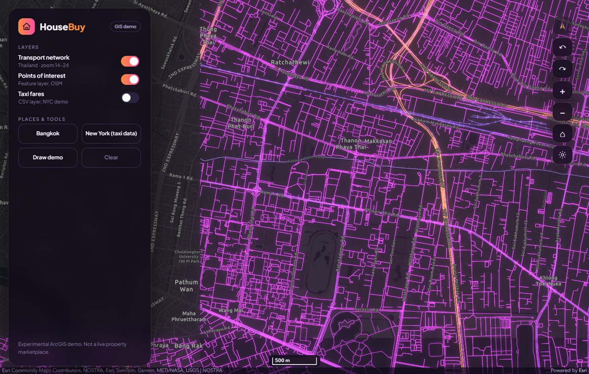
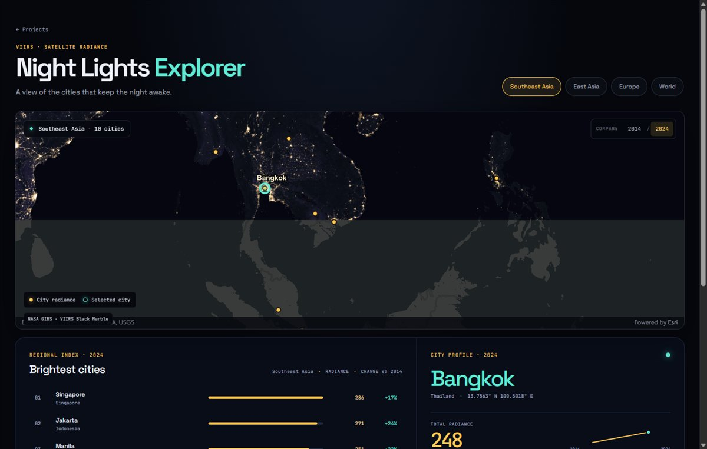
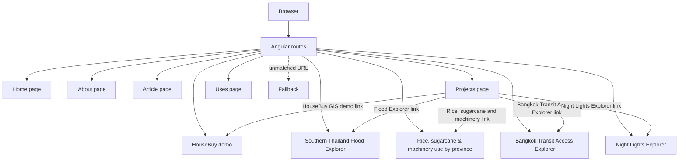
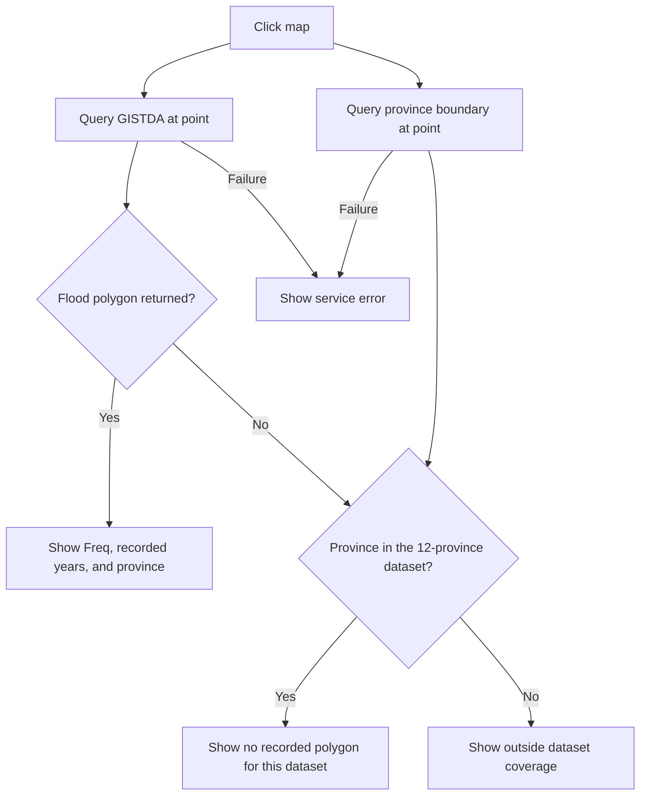
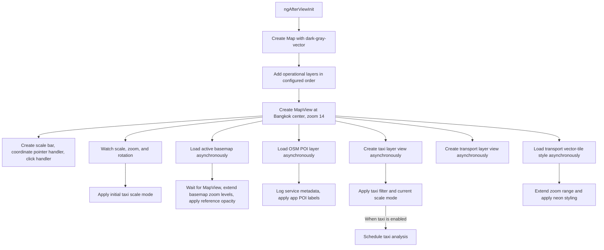
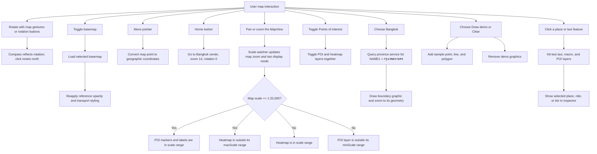
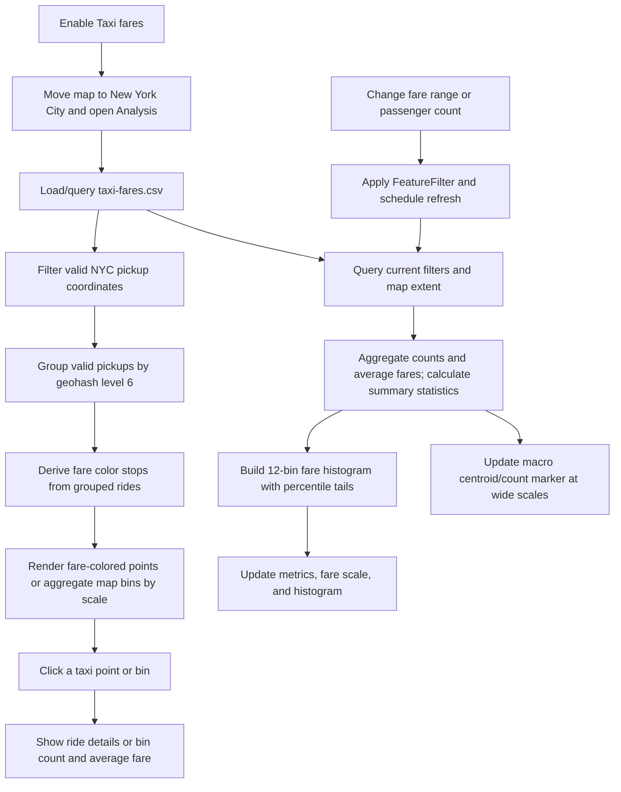

# GIS App

A personal portfolio website built with Angular. Its **HouseBuy** page appears in Projects as **HouseBuy GIS demo**. HouseBuy is an experimental ArcGIS mapping demo; it is not a real estate buying or selling service, and it does not provide live property listings.

## Project previews

| HouseBuy GIS demo | Night Lights Explorer |
| --- | --- |
|  |  |
| [Project guide](docs/housebuy-gis.md) · Bangkok transport network and OSM places. | [Project guide](docs/night-lights.md) · NASA night imagery and city summaries; summary values are illustrative placeholders. |

## Features

### Portfolio website

- Home page with profile content, articles, and portfolio navigation.
- About, Articles, Projects, and Uses pages.
- Uses page with a concise list of web development and mapping tools: Angular, TypeScript, Tailwind CSS, and ArcGIS Maps SDK.
- HouseBuy GIS demo linked from the Projects page.
- Southern Thailand Flood Explorer at `/flood`, linked from the Projects page and available as a direct lazy-loaded route; it is not in the navigation pill.
- **Rice, sugarcane & machinery use by province** at `/agriculture`, linked from the Projects page and available as a direct lazy-loaded route; it is not in the navigation pill.
- **Bangkok Transit Access Explorer** at `/transit-access`, linked from the Projects page and available as a direct lazy-loaded route; it is not in the navigation pill.
- **Night Lights Explorer** at `/night-lights`, linked from the Projects page and available as a direct lazy-loaded route; it is not in the navigation pill.

### HouseBuy GIS demo

- Rotatable 2D map with compass and north reset, metric scale bar, live coordinate readout, home view, and dark/satellite basemap toggle.
- Graphics layer demo with point, line, and polygon graphics, plus a clear action.
- Neon-styled Thailand Transportation vector-tile network.
- OSM points of interest with halo labels at close scales and a heatmap at wider scales.
- Bangkok boundary query and outline from a province feature service.
- New York City taxi fare analysis from a CSV layer: geohash-based fare ramp, fare-colored points, aggregated map bins, histogram, passenger and fare filters, summary metrics, and an inspector for selected places, rides, and bins.

### Southern Thailand Flood Explorer

- Historical GISTDA recurrent flood-prone areas for 2011–2020, covering 12 southern provinces: Nakhon Si Thammarat, Songkhla, Phatthalung, Surat Thani, Narathiwat, Pattani, Yala, Trang, Chumphon, Satun, Phang-nga, and Krabi.
- Uses an ArcGIS `MapImageLayer` for server-rendered flood polygons, the existing Thailand province-boundary service for outlines and location checks, and OSM places that appear when zoomed in.
- Clicking the map queries the flood service at the selected point and queries the province boundary. The page reports recurrence and recorded years when a polygon intersects, distinguishes a covered province with no matching polygon from locations outside the dataset coverage, and shows an error state when a service request fails.
- This is historical data, not a live flood map. Coverage density varies substantially by province; Krabi and Phang-nga have very few records, and the dataset may be incomplete. Follow official announcements for safety decisions.

### Rice, sugarcane & machinery use by province

- Compares wet-season rice planted area, forecast sugarcane planted area (`CaneArea`), and the share of holders reporting any machinery use by province.
- Uses provincial records bundled in `src/app/pages/agriculture-page/province-data.json` and province geometries queried from the existing Thailand province-boundary service. The page supports choropleth colors, dot-density views for rice and sugarcane, province hover and click details, and a keyboard-accessible Top 10 list.
- Rice and sugarcane values are for crop/production year 2565/66. Rice area is in rai; the sugarcane unit is not confirmed. The machinery share is calculated from holders reporting machinery use divided by holders reporting, but the year is not stated in the supplied file (the NSO catalog identifies 2566).
- These are province-level summaries, not household-level records. Machinery data does not identify machine types. Dot positions are randomized within provinces and do not represent actual field locations; sugarcane dot units are unconfirmed.

### Bangkok Transit Access Explorer

- Maps the share of each Bangkok district's population in the supplied category `1` for three summaries: 400 m public transport areas, 500 m bus-stop areas, and 1,000 m public transport areas. The 500 m file is specifically labelled `trans_bus_stop`.
- Overlays bundled Bangkok rail lines and stations, with station halos colored by the access share of the containing district. These halos are district-level context, not measured station catchments.
- Includes a station search and rail route planner. Current fare tables are not bundled, so it can show routes but does not return fare quotes; the Common · 2027 mode is disabled.
- The page uses a compact derived district summary from the three catalog CSV resources and queries Bangkok district geometries from an ArcGIS feature service. The original CSV files are not included in the repository.
- The supplied tables use `FID` categories `-1` and `1`; the page interprets `1` as a spatial match to the access area and `-1` as no match. The catalog provides no field dictionary, so this interpretation remains unconfirmed. The population totals differ slightly across files, and the three resources use separate layers; their results are not a controlled comparison of distance alone.
- The catalog does not specify a reuse license for the transit dataset. Contact the Bangkok Metropolitan Administration before redistribution.
- The catalog last updated the transit-access resources on November 11, 2024; the underlying population reference year is not stated.

### Night Lights Explorer

- Shows NASA GIBS VIIRS Black Marble night imagery with a year selector, regional city markers and city ranking for Southeast Asia, East Asia, Europe, and a global set. At closer scales it offers a swipe comparison with daytime satellite imagery.
- City radiance, change, and lit-area figures come from `src/assets/night-lights/cities.json` and are illustrative placeholders, not measured VIIRS zonal statistics. The year selector changes these local figures; it does not select a matching year of satellite imagery.
- NASA imagery and Esri daytime imagery load from remote services and require an internet connection.

## Tech stack

Versions below are the ranges declared in `package.json`.

| Technology | Version |
| --- | --- |
| Angular | `^21.0.0` (CLI/build `^21.0.5`) |
| ArcGIS Maps SDK for JavaScript | `@arcgis/core ^4.34.8`; map components package `^4.34.9` |
| PrimeNG | `^21.0.2` |
| Tailwind CSS | `^4.1.18` |
| RxJS | `~7.8.0` |
| TypeScript | `~5.9.2` |
| Vitest | `^4.0.8` |
| npm package manager | `11.7.0` |

## Project guides

The [`docs/`](docs/README.md) folder explains how each interactive mapping project works, where it gets its data, and how to interpret its results:

- [HouseBuy GIS demo](docs/housebuy-gis.md)
- [Southern Thailand Flood Explorer](docs/flood-explorer.md)
- [Agriculture by province](docs/agriculture-explorer.md)
- [Bangkok Transit Access Explorer](docs/bangkok-transit-access.md)
- [Night Lights Explorer](docs/night-lights.md)

## Getting started

Use Node.js and npm compatible with the installed Angular toolchain, then run:

```bash
npm install
npm start
```

The development server is provided by Angular CLI. The other package scripts are:

```bash
npm run watch  # Development build in watch mode
npm run build  # Production build
npm test       # Run the configured test command
```

## Routes

Routes are lazy-loaded in `src/app/app.routes.ts`.

| Path | Page |
| --- | --- |
| `/` | Home |
| `/about` | About |
| `/article` | Article |
| `/project` | Projects |
| `/uses` | Uses |
| `/demo-gis` | HouseBuy GIS demo |
| `/flood` | Southern Thailand Flood Explorer |
| `/agriculture` | Rice, sugarcane & machinery use by province |
| `/transit-access` | Bangkok Transit Access Explorer |
| `/night-lights` | Night Lights Explorer |
| Any unmatched path | Not Found |

## Application flow

### Website navigation



### Flood Explorer location-check flow

The flood page starts over Southern Thailand with a GISTDA map-image layer and province outlines. A click sends two point queries in parallel: an intersect query to GISTDA for `Freq`, the 2011–2020 fields, and province labels; and an intersect query to the province-boundary service for province name and code. The result is classified as a recorded flood-prone area, a covered province with no matching polygon, or outside the 12-province coverage. Query failures are shown as errors rather than being interpreted as an outside-coverage result.



### HouseBuy startup and layer requests

`ngAfterViewInit()` creates the map and view first. Basemap loading, POI loading, layer-view creation, and vector-tile style loading are then started independently; there is no serial wait for every layer before the map is usable.



The map's operational layer order is heatmap, POI, taxi CSV, transport vector tiles, taxi macro graphics, Bangkok boundary graphics, demo graphics, and taxi selection graphics. Later graphics layers are available for drawing selections and overlays. POI and heatmap use the same OSM service but are separate layers.

### Map interactions and scale-dependent content



The POI switch enables both OSM layers. Their scale limits determine which renderer is in range: POI has `minScale: 20000`, while heatmap has `maxScale: 20000`. Taxi display modes are macro beyond scale 1:1,000,000, city bins between 1:1,000,000 and 1:40,000, and individual points at scale 1:40,000 or closer. City bins use fixed geohash level 6 and show ride-count labels from 10 rides upward.

### Taxi fare analysis



The initial fare ramp uses geohash groups for eligible NYC rides; the map's city-scale aggregation is ArcGIS feature reduction with fixed bin level 6. Fare and passenger filters update the feature-layer filter and trigger refreshed queries. Summary metrics are scoped to the current map extent; the histogram covers the filtered dataset and uses 12 central bins between P1 and P95 plus tails.

## Data sources

HouseBuy requests these remote sources, so an internet connection is required:

- [Thailand_Transportation vector tile service](https://tiles.arcgis.com/tiles/jSaRWj2TDlcN1zOC/arcgis/rest/services/Thailand_Transportation/VectorTileServer) — transport network.
- [OSM_AS_POIs feature service](https://services-ap1.arcgis.com/iA7fZQOnjY9D67Zx/ArcGIS/rest/services/OSM_AS_POIs/FeatureServer/0) — points of interest and heatmap.
- [Thailand_Province_Boundaries_view feature service](https://services1.arcgis.com/jSaRWj2TDlcN1zOC/ArcGIS/rest/services/Thailand_Province_Boundaries_view/FeatureServer/1) — Bangkok boundary query.
- [jeffprosise/Machine-Learning taxi-fares.csv](https://github.com/jeffprosise/Machine-Learning/blob/master/Data/taxi-fares.csv) — New York City pickup coordinates and fare attributes.

The Flood Explorer additionally requests these public ArcGIS services:

- [GISTDA recurrent flood-prone areas, 2011–2020](https://gistdaportal.gistda.or.th/data/rest/services/FL_Flood/flood_freq11_20/MapServer/0) — server-rendered polygons and point queries; the layer covers only the 12 southern provinces. No API key is required by the current service endpoint. The service metadata did not specify a reuse license; contact GISTDA before redistribution.
- [Thailand_Province_Boundaries_view feature service](https://services1.arcgis.com/jSaRWj2TDlcN1zOC/ArcGIS/rest/services/Thailand_Province_Boundaries_view/FeatureServer/1) — province outlines and point-in-province queries. Service attribution: Globetech Co.,Ltd., MERKATOR Co.,Ltd.
- [OSM_AS_POIs feature service](https://services-ap1.arcgis.com/iA7fZQOnjY9D67Zx/ArcGIS/rest/services/OSM_AS_POIs/FeatureServer/0) — OSM places, shown at closer map scales.

The Agriculture Explorer uses the province-boundary feature service above to retrieve province geometries. Its indicator values are bundled in `src/app/pages/agriculture-page/province-data.json` from these named sources:

- Office of Agricultural Economics (OAE) — wet-season rice planted area for 2565/66, reported in rai; the bundled metadata identifies the license as Open Data Common.
- Office of the Cane and Sugar Board (OCSB) — forecast planted area (`CaneArea`) for 2565/66; the supplied dictionary does not confirm the unit or license.
- National Statistical Office (NSO) — counts of holders reporting machinery use and holders reporting; the supplied CSV does not state a year, while the catalog identifies 2566. The bundled metadata identifies the license as CC BY.
- Province boundaries are credited in the page to Globetech Co.,Ltd. and MERKATOR Co.,Ltd.; the reuse license is not confirmed.

The Bangkok Transit Access Explorer uses the public [Bangkok transit-access dataset](https://data.go.th/en/dataset/trans_service). Its 400 m and 1,000 m summary tables and the 500 m bus-stop summary are derived into a small local JSON file. District geometry comes from the public [TH_Bangkok_District feature service](https://services1.arcgis.com/jSaRWj2TDlcN1zOC/ArcGIS/rest/services/TH_Bangkok_District/FeatureServer/0). The transit dataset license and the boundary service reuse terms are not confirmed in the available metadata.

The Night Lights Explorer requests [NASA GIBS VIIRS Black Marble imagery](https://gibs.earthdata.nasa.gov/wmts/epsg3857/best) and [Esri World Imagery](https://services.arcgisonline.com/ArcGIS/rest/services/World_Imagery/MapServer) for its map and swipe comparison. City markers and radiance summaries are bundled in `src/assets/night-lights/cities.json`; their radiance, change, and lit-area values are illustrative placeholders, not measured satellite statistics.

## Known limitations

- HouseBuy is an ArcGIS experiment, not a real estate marketplace or transaction system.
- GISTDA flood data is historical and its reuse license is unspecified in the service metadata. It must not be treated as a live flood warning or a complete record of all flood-prone locations.
- Agriculture indicators are aggregated by province. The sugarcane unit and reuse license, and the province-boundary reuse license, are not confirmed in the bundled metadata.
- Transit-access categories are interpreted from the supplied `FID` values because no field dictionary was provided. The 400 m, 500 m bus-stop, and 1,000 m summaries may use different source layers and should not be read as a clean distance-only comparison. Their reuse licenses are unconfirmed.
- Night Lights city radiance, change, and lit-area values are illustrative placeholders. They must not be interpreted as measured VIIRS statistics; the year selector affects the local city summaries, not the imagery date.
- Diagnostic `console` logging remains in `src/app/pages/demo-gis-page/demo-gis-page.ts`.
