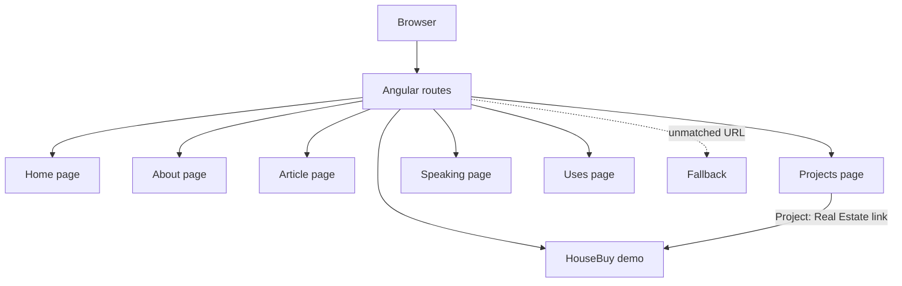
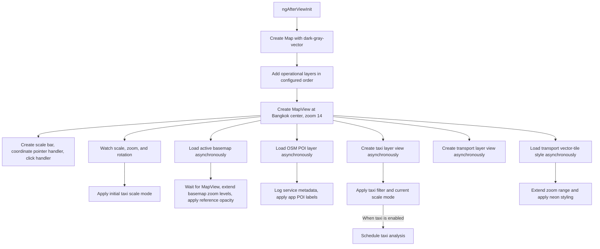
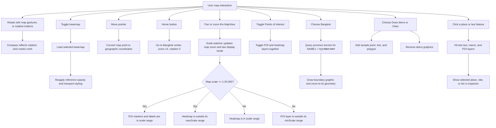
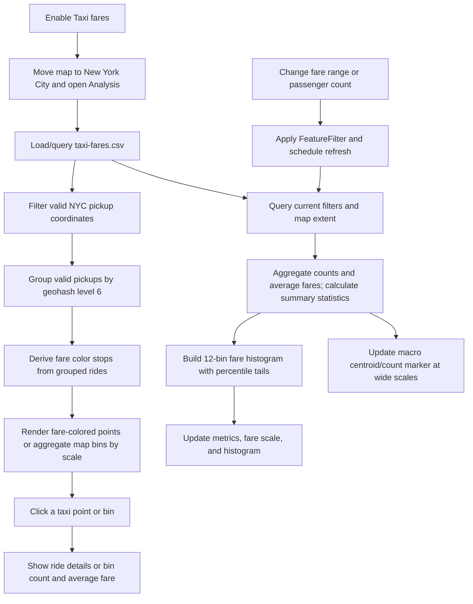

# GIS App

A personal portfolio website built with Angular. Its **HouseBuy** page appears in Projects as **Project: Real Estate**. HouseBuy is an experimental ArcGIS mapping demo; it is not a real estate buying or selling service, and it does not provide live property listings.

## Features

### Portfolio website

- Home page with profile content, articles, and portfolio navigation.
- About, Articles, Projects, Speaking, and Uses pages.
- HouseBuy GIS demo linked from the Projects page.

### HouseBuy GIS demo

- Rotatable 2D map with compass and north reset, metric scale bar, live coordinate readout, home view, and dark/satellite basemap toggle.
- Graphics layer demo with point, line, and polygon graphics, plus a clear action.
- Neon-styled Thailand Transportation vector-tile network.
- OSM points of interest with halo labels at close scales and a heatmap at wider scales.
- Bangkok boundary query and outline from a province feature service.
- New York City taxi fare analysis from a CSV layer: geohash-based fare ramp, fare-colored points, aggregated map bins, histogram, passenger and fare filters, summary metrics, and an inspector for selected places, rides, and bins.

## Tech stack

Versions below are the ranges declared in `package.json`.

| Technology | Version |
| --- | --- |
| Angular | `^21.0.0` (CLI/build `^21.0.5`) |
| ArcGIS Maps SDK for JavaScript | `@arcgis/core ^4.34.8`; map components package `^4.34.9` |
| PrimeNG | `^21.0.2` |
| Tailwind CSS | `^4.1.18` |
| RxJS | `~7.8.0` |
| TypeScript | `~5.9.2` |
| Vitest | `^4.0.8` |
| npm package manager | `11.7.0` |

## Getting started

Use Node.js and npm compatible with the installed Angular toolchain, then run:

```bash
npm install
npm start
```

The development server is provided by Angular CLI. The other package scripts are:

```bash
npm run watch  # Development build in watch mode
npm run build  # Production build
npm test       # Run the configured test command
```

## Routes

Routes are lazy-loaded in `src/app/app.routes.ts`.

| Path | Page |
| --- | --- |
| `/` | Home |
| `/about` | About |
| `/article` | Article |
| `/project` | Projects |
| `/speaking` | Speaking |
| `/uses` | Uses |
| `/demo-gis` | HouseBuy GIS demo |
| Any unmatched path | Not Found |

## Application flow

### Website navigation



### HouseBuy startup and layer requests

`ngAfterViewInit()` creates the map and view first. Basemap loading, POI loading, layer-view creation, and vector-tile style loading are then started independently; there is no serial wait for every layer before the map is usable.



The map's operational layer order is heatmap, POI, taxi CSV, transport vector tiles, taxi macro graphics, Bangkok boundary graphics, demo graphics, and taxi selection graphics. Later graphics layers are available for drawing selections and overlays. POI and heatmap use the same OSM service but are separate layers.

### Map interactions and scale-dependent content



The POI switch enables both OSM layers. Their scale limits determine which renderer is in range: POI has `minScale: 20000`, while heatmap has `maxScale: 20000`. Taxi display modes are macro beyond scale 1:1,000,000, city bins between 1:1,000,000 and 1:40,000, and individual points at scale 1:40,000 or closer. City bins use fixed geohash level 6 and show ride-count labels from 10 rides upward.

### Taxi fare analysis



The initial fare ramp uses geohash groups for eligible NYC rides; the map's city-scale aggregation is ArcGIS feature reduction with fixed bin level 6. Fare and passenger filters update the feature-layer filter and trigger refreshed queries. Summary metrics are scoped to the current map extent; the histogram covers the filtered dataset and uses 12 central bins between P1 and P95 plus tails.

## Data sources

HouseBuy requests these remote sources, so an internet connection is required:

- [Thailand_Transportation vector tile service](https://tiles.arcgis.com/tiles/jSaRWj2TDlcN1zOC/arcgis/rest/services/Thailand_Transportation/VectorTileServer) — transport network.
- [OSM_AS_POIs feature service](https://services-ap1.arcgis.com/iA7fZQOnjY9D67Zx/ArcGIS/rest/services/OSM_AS_POIs/FeatureServer/0) — points of interest and heatmap.
- [Thailand_Province_Boundaries_view feature service](https://services1.arcgis.com/jSaRWj2TDlcN1zOC/ArcGIS/rest/services/Thailand_Province_Boundaries_view/FeatureServer/1) — Bangkok boundary query.
- [jeffprosise/Machine-Learning taxi-fares.csv](https://github.com/jeffprosise/Machine-Learning/blob/master/Data/taxi-fares.csv) — New York City pickup coordinates and fare attributes.

## Known limitations

- HouseBuy is an ArcGIS experiment, not a real estate marketplace or transaction system.
- The latest production build reported an initial bundle of **878.60 kB**, above the configured **500 kB** budget.
- Diagnostic `console` logging remains in `src/app/pages/demo-gis-page/demo-gis-page.ts`.
