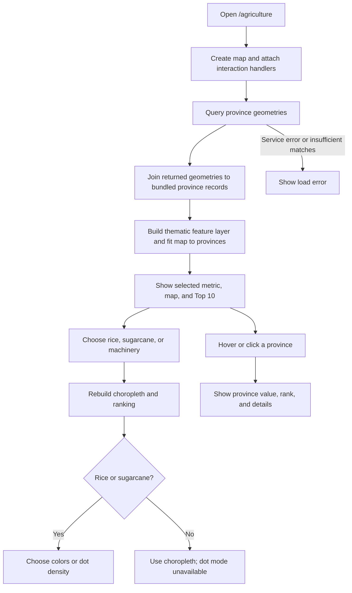

# Agriculture by province

**Route:** [`/agriculture`](../src/app/app.routes.ts)  
**Page implementation and data:** [`src/app/pages/agriculture-page/`](../src/app/pages/agriculture-page/agriculture-page.ts)

This page compares three province-level indicators: wet-season rice planted area, forecast sugarcane planted area, and reported use of agricultural machinery. The records are bundled in `province-data.json`; province geometries are queried from the Thailand province-boundary feature service.

## Flow

## Metrics

| Metric | Value shown | Data notes |
| --- | --- | --- |
| Rice | Wet-season rice planted area | Rai; crop year 2565/66; OAE source. |
| Sugarcane | Forecast planted area (`caneArea`) | Crop year 2565/66; the supplied data does not confirm the unit; OCSB source. |
| Machinery | Share reporting any machinery use | `machineryUsed / machineryReported × 100`; the supplied file does not state its year. The NSO catalog identifies 2566. |

The calculation helpers are in [`agriculture-utils.ts`](../src/app/pages/agriculture-page/agriculture-utils.ts), and the bundled province records are in [`province-data.json`](../src/app/pages/agriculture-page/province-data.json).

## Map and ranking

The metric selector drives a province choropleth and the Top 10 ranking. Rice and sugarcane also support a dot-density view; machinery does not. Province hover and selection expose the relevant value and rank. Dot counts are capped to keep the map readable (about 400 per province and 8,000 overall); their positions are randomized within province boundaries and do not indicate actual fields or farms.

## Limits

These are province-level summaries, not household records. The sugarcane unit is unconfirmed, and the machinery source year is absent from the supplied file. The machinery statistic does not identify machine type or intensity. Do not compare the three indicators as if they shared a single measurement method or reference year.

## Key implementation files

- [`agriculture-page.ts`](../src/app/pages/agriculture-page/agriculture-page.ts) — page state, map setup, data joins, ranking, and interactions.
- [`agriculture-utils.ts`](../src/app/pages/agriculture-page/agriculture-utils.ts) — metric calculations and dot-density helpers.
- [`province-data.json`](../src/app/pages/agriculture-page/province-data.json) — bundled records.
- [`agriculture-page.html`](../src/app/pages/agriculture-page/agriculture-page.html) and [`agriculture-page.css`](../src/app/pages/agriculture-page/agriculture-page.css) — UI and styling.
