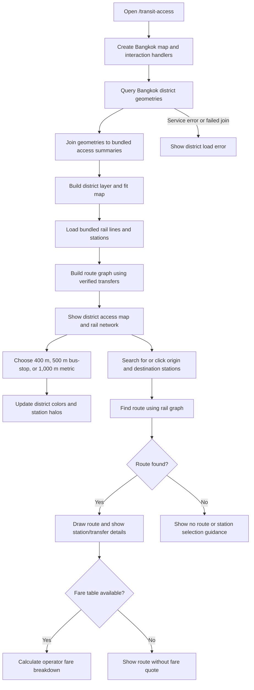

# Bangkok Transit Access Explorer

**Route:** [`/transit-access`](../src/app/app.routes.ts)  
**Page implementation:** [`src/app/pages/transit-access-page/transit-access-page.ts`](../src/app/pages/transit-access-page/transit-access-page.ts)

The page combines district-level transit-access summaries, Bangkok rail lines and stations, and a fare calculator. The access summaries describe district categories; halo colors use the access share for the containing district and are not measured station catchments.

## Flow

## District access summaries

The compact local summary is [`transit-access-data.json`](../src/app/pages/transit-access-page/transit-access-data.json). It was derived from three data.go.th resources; the original CSVs are not bundled. The summaries cover 400 m public-transport areas, a 500 m `trans_bus_stop` layer, and 1,000 m public-transport areas. District geometries are queried from the Bangkok district feature service.

The source tables provide `FID` categories `-1` and `1`. The application interprets `1` as a spatial access match, but the catalog has no field dictionary to confirm that meaning. Totals vary slightly between the resources, which are separate layers, so they are not a controlled comparison of distance alone. The catalog updated these resources on 2024-11-11; the population reference year is unstated and reuse terms are unclear.

## Rail data and graph

The bundled OSM extracts are [`bangkok-rail-lines.geojson`](../src/assets/data/bangkok-rail-lines.geojson) and [`bangkok-rail-stations.geojson`](../src/assets/data/bangkok-rail-stations.geojson). [`fetch-rail.mjs`](../scripts/fetch-rail.mjs) retrieves route and station data from Overpass for the Bangkok-area bounding box and classifies rail line families. The script currently is not registered as an npm script; run it directly with `node scripts/fetch-rail.mjs` when you intend to refresh those generated files. It requires network access to Overpass.

The route graph in [`fare-routing.ts`](../src/app/pages/transit-access-page/fare-routing.ts) represents stations on lines as graph nodes. Consecutive stations on a line form travel edges; transfer edges are included only when the station pair in [`rail-interchanges.json`](../src/assets/data/rail-interchanges.json) is marked `verified: true`. The interchange builder generates proximity candidates within about 250 m for review; proximity alone does not confirm a walkable transfer. Dijkstra routing minimizes station travel cost plus a transfer penalty.

## Fares and fare modes

Operator fare definitions are in [`fares.json`](../src/assets/data/fares.json). Each entry has a rule type, fare table, currency, `asOf`, source URL, notes, and a status. Missing fare tables remain empty with `status: "missing"`; the UI reports fare unavailability rather than inventing a total.

- **Current fares:** operators charge independently. Transfers between operators are separate fares. Any caps are documented as notes and are not calculated.
- **Common · 2027:** disabled until official rules are published. Its configurable 17–45 baht range is a placeholder and is not used as a fare quote.

The calculator returns the ordered stations and line segments, transfer points, station and transfer counts, and an operator fare breakdown when source fare data is available. “Estimate” should be read literally; discounts and fare caps are not applied.

## Map interaction and display

Search the bilingual station list or click stations on the map to set the trip endpoints. Selecting a route draws it above the rail lines and dims other map content. The planner also exposes a selected-district summary. Station halos are colored from the containing district's access share, not from an individually measured station catchment. At city scale, only interchange halos are shown; regular stations appear at closer scales.

## Key implementation files

- [`transit-access-page.ts`](../src/app/pages/transit-access-page/transit-access-page.ts) — view, map layers, planner UI state, and page interactions.
- [`fare-routing.ts`](../src/app/pages/transit-access-page/fare-routing.ts) — rail graph, route search, and fare calculation.
- [`transit-access-utils.ts`](../src/app/pages/transit-access-page/transit-access-utils.ts) — access and station display helpers.
- [`transit-access-data.json`](../src/app/pages/transit-access-page/transit-access-data.json) — district summary data.
- [`rail-interchanges.json`](../src/assets/data/rail-interchanges.json) and [`fares.json`](../src/assets/data/fares.json) — transfer review and fare records.
- [`fetch-rail.mjs`](../scripts/fetch-rail.mjs) and [`build-rail-interchanges.mjs`](../scripts/build-rail-interchanges.mjs) — rail data generation scripts.
