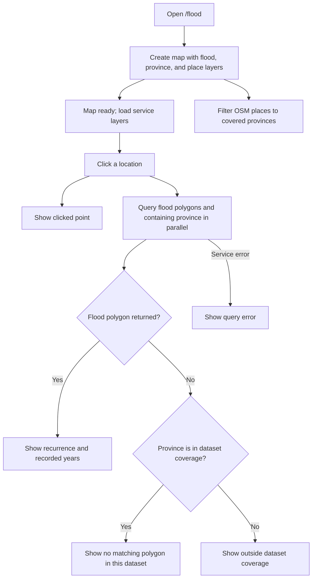

# Southern Thailand Flood Explorer

**Route:** [`/flood`](../src/app/app.routes.ts)  
**Page implementation:** [`src/app/pages/flood-page/`](../src/app/pages/flood-page/flood-page.ts)

The page maps GISTDA recurrent flood-prone areas recorded for 2011–2020 across 12 southern provinces. It is historical information, not a live flood forecast or safety warning.

## Flow

## Data and map layers

- A GISTDA `MapImageLayer` renders the flood recurrence polygons. The page styles the `Freq` field with class breaks and reads year attributes (`Y_2011` through `Y_2020`; the 2017 field is named `Y2017` in the service).
- A Thailand province-boundary feature service provides outlines and checks which province contains a clicked location.
- OSM places are filtered to the union of the covered southern provinces and displayed at closer scales.

The flood service is `https://gistdaportal.gistda.or.th/data/rest/services/FL_Flood/flood_freq11_20/MapServer`. Province and OSM service URLs are configured in the page source.

## Click query and result states

Clicking the map sends a point-intersection query to the flood service and a point query to the province service concurrently. A returned flood polygon yields recurrence, recorded years, and province details. If there is no polygon, the province result distinguishes a location inside the covered provinces from a location outside the dataset coverage. A service failure is shown as an error rather than being treated as “no flood.”

## Limits

Coverage is uneven and the source may be incomplete. The source has few records for some provinces, including Krabi and Phang-nga. A blank result means no matching polygon was returned from this dataset; it does not establish that flooding did not occur. Follow current official announcements for safety decisions. Confirm source reuse terms before redistributing the data.

## Key implementation files

- [`flood-page.ts`](../src/app/pages/flood-page/flood-page.ts) — layers, map interactions, and asynchronous queries.
- [`flood-utils.ts`](../src/app/pages/flood-page/flood-utils.ts) — recurrence classification and legend helpers.
- [`flood-page.html`](../src/app/pages/flood-page/flood-page.html) and [`flood-page.css`](../src/app/pages/flood-page/flood-page.css) — UI and styling.
