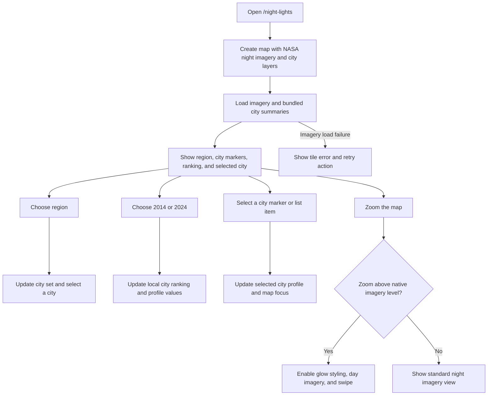

# Night Lights Explorer

**Route:** [`/night-lights`](../src/app/app.routes.ts)  
**Page implementation:** [`src/app/pages/night-lights-page/night-lights-page.ts`](../src/app/pages/night-lights-page/night-lights-page.ts)

The map displays NASA GIBS VIIRS Black Marble imagery and bundled city markers for Southeast Asia, East Asia, Europe, and a global set. Select a region, city, and summary year to update the local city ranking and profile. At closer scales, a swipe control compares the night imagery with Esri daytime satellite imagery.

## Flow

The 2014 and 2024 radiance values, percentage changes, and lit-area values in [`cities.json`](../src/assets/night-lights/cities.json) are illustrative placeholders for interface development. They are not measured VIIRS zonal statistics. The year selector changes these local summaries; it does not change the date of the NASA imagery.

## Data sources and limitations

- Night imagery: [NASA GIBS WMTS](https://gibs.earthdata.nasa.gov/wmts/epsg3857/best), layer `VIIRS_Black_Marble`.
- Daytime imagery for the swipe comparison: [Esri World Imagery](https://services.arcgisonline.com/ArcGIS/rest/services/World_Imagery/MapServer).
- City locations and illustrative summary values: [`src/assets/night-lights/cities.json`](../src/assets/night-lights/cities.json).

Both imagery layers require an internet connection. Do not use the placeholder city values as scientific or measured satellite results.
